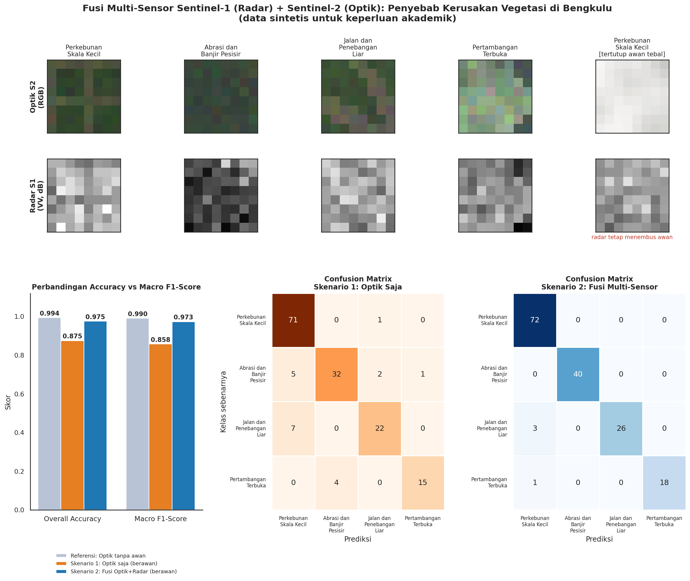

# Multi-Sensor Satellite AI: Klasifikasi Penyebab Kerusakan Vegetasi Pesisir dan Hutan Penyangga Bengkulu

**Fusi Data Radar (Sentinel-1) dan Optik (Sentinel-2) untuk Atribusi *Direct Drivers* Peringatan Deforestasi**

**Mata Kuliah / Tugas:** *Attributing Direct Drivers to Deforestation Alerts with Satellite Imagery and AI*
**Teknologi:** Python · NumPy · Pandas · scikit-learn · Matplotlib · Seaborn

> **Catatan penting:** seluruh citra pada proyek ini adalah **data sintetis (simulasi)** yang dibangkitkan program untuk keperluan akademik. Angka akurasi menggambarkan perilaku model pada data simulasi, **bukan** performa pada citra satelit nyata.

**Referensi teori:** materi kuliah praktisi Dr. Bart Slagter (Wageningen University & Research) tentang penggabungan 2 band radar Sentinel-1 dan 4 band optik Sentinel-2, klasifikasi penyebab langsung (*direct drivers*) pada dataset tidak seimbang, serta evaluasi dengan *Overall Accuracy* vs *Macro F1-Score*.



---

## Daftar Isi

1. [Latar Belakang Studi Kasus Bengkulu](#1-latar-belakang-studi-kasus-bengkulu)
2. [Mengapa Menggabungkan Satelit Optik dan Radar?](#2-mengapa-menggabungkan-satelit-optik-sentinel-2-dan-radar-sentinel-1)
3. [Alur Kerja Model AI](#3-alur-kerja-model-ai)
4. [Analisis Overall Accuracy vs Macro F1-Score](#4-analisis-overall-accuracy-vs-macro-f1-score)
5. [Contoh Hasil Eksperimen](#5-contoh-hasil-eksperimen)
6. [Panduan Menjalankan Program](#6-panduan-menjalankan-program)
7. [Struktur Proyek](#7-struktur-proyek)
8. [Keterbatasan](#8-keterbatasan)
9. [Referensi](#9-referensi)

---

## 1. Latar Belakang Studi Kasus Bengkulu

Provinsi Bengkulu membentang di pesisir barat Sumatra dan berbatasan dengan kawasan hutan penyangga serta kawasan konservasi di Bukit Barisan. Dalam satu bentang lahan yang relatif sempit, vegetasi dapat rusak karena penyebab yang sangat berbeda:

| Penyebab langsung (*direct driver*) | Gambaran di Bengkulu | Konsekuensi penanganan |
|---|---|---|
| **Perkebunan Skala Kecil** | Pembukaan lahan untuk kebun (misalnya sawit atau karet) di tepi hutan penyangga. | Pendampingan petani, legalitas lahan. |
| **Abrasi dan Banjir Pesisir** | Pengikisan garis pantai dan genangan di dataran rendah pesisir. | Mitigasi bencana, rehabilitasi mangrove/pesisir. |
| **Jalan dan Penebangan Liar** | Jalur sempit dan memanjang yang membelah tutupan hutan. | Patroli dan penegakan hukum kehutanan. |
| **Pertambangan Terbuka** | Hamparan tanah terbuka dengan lubang atau teras galian. | Pengawasan perizinan dan reklamasi. |

Sistem peringatan deforestasi biasanya hanya memberi tahu **bahwa** tutupan vegetasi berubah, tidak **mengapa**. Padahal tindak lanjut di lapangan sangat bergantung pada penyebabnya. Proyek ini mensimulasikan tahap **atribusi**: setelah sebuah peringatan muncul, patch citra di lokasi tersebut diklasifikasikan ke salah satu dari empat penyebab langsung.

Tantangan khas wilayah tropis seperti Bengkulu:

1. **Tutupan awan yang sering dan tebal** membuat citra optik tidak dapat dipakai pada banyak waktu pengamatan.
2. **Dataset tidak seimbang**: penyebab yang paling sering (kebun kecil) jauh lebih banyak daripada penyebab yang jarang tetapi penting (tambang terbuka).

**Komposisi dataset sintetis (800 patch, 8×8 piksel, 6 band):**

| Kelas | Porsi | Ciri yang disimulasikan |
|---|---|---|
| `Perkebunan_Skala_Kecil` | 45% (360) | NIR sedang; pola kotak teratur (periode 4 piksel); radar vegetasi sedang |
| `Abrasi_dan_Banjir_Pesisir` | 25% (200) | NIR sangat rendah; hamburan balik radar VV/VH sangat rendah karena genangan air |
| `Jalan_dan_Penebangan_Liar` | 18% (144) | Pola garis memanjang pada patch (kadang bercabang) |
| `Pertambangan_Terbuka` | 12% (96) | Tanah terbuka: Red/Blue tinggi, NIR sangat rendah; teras galian, kadang kolam atau revegetasi |

Piksel Sentinel berukuran sekitar 10 m, sehingga satu patch 8×8 mewakili area sekitar 80 m × 80 m.

---

## 2. Mengapa Menggabungkan Satelit Optik (Sentinel-2) dan Radar (Sentinel-1)?

| Aspek | Sentinel-2 (Optik) | Sentinel-1 (Radar SAR) |
|---|---|---|
| **Band dalam proyek** | 4 band: Red, Green, Blue, NIR | 2 band: VV dan VH |
| **Sumber informasi** | Pantulan cahaya matahari: warna, kehijauan vegetasi, tanah terbuka | Hamburan balik gelombang mikro: kekasaran, struktur, kandungan air |
| **Terhadap awan** | **Terhalang awan, kabut, dan bayangan awan** | **Menembus awan** dan bisa merekam siang/malam |
| **Kekuatan khas** | NIR membedakan vegetasi sehat dan lahan terbuka; indeks seperti NDVI/NDWI | Air tenang memantul menjauh (specular) sehingga gelap; jalan halus dan tanah terbuka berbeda dari tajuk |
| **Kelemahan** | Tidak ada informasi di bawah awan | Derau *speckle* tinggi; sulit dibaca sendirian oleh manusia |

Keduanya saling melengkapi. Optik unggul membedakan jenis tutupan secara spektral saat langit cerah, sedangkan radar tetap konsisten saat langit tertutup dan sangat peka terhadap air dan struktur permukaan. Pada simulasi ini:

- **Tahap awan (30% sampel):** hanya Band 1-4 (optik) yang dirusak oleh awan tebal, kabut tipis, atau bayangan awan. Band 5-6 (radar) **tetap bersih dan konsisten**. Program memverifikasi hal ini dengan `assert` bahwa radar identik sebelum dan sesudah simulasi awan.
- **Dampaknya:** pada sampel berawan, optik saja nyaris "buta", sedangkan model fusi masih dapat mengandalkan radar.

---

## 3. Alur Kerja Model AI

```
Tahap 1  Generator patch sintetis      800 patch x 6 band x 8 x 8, 4 kelas imbalanced
   │
Tahap 2  Simulasi awan tropis          30% sampel: Band 1-4 rusak, Band 5-6 tetap bersih
   │
Ekstraksi fitur                        statistik band + indeks + fitur spasial kontekstual
   │
Tahap 3  Eksperimen (split 80/20, stratified)
   │       Skenario 1: Optik saja (17 fitur)         -> penurunan saat berawan
   │       Skenario 2: Fusi Optik + Radar (29 fitur) -> pemulihan akurasi
   │       (+ referensi: optik pada langit cerah)
   │
Tahap 4  Evaluasi                      Accuracy vs Macro F1 + Classification Report
   │
Tahap 5  Visualisasi                   hasil_analisis_satelit.png
```

### 3.1 Urutan band

| Band | Kanal | Sensor | Satuan |
|---|---|---|---|
| 1-4 | Red, Green, Blue, NIR | Sentinel-2 | Reflektansi (0-1) |
| 5-6 | VV, VH | Sentinel-1 | Desibel (dB) |

### 3.2 Fitur

| Kelompok | Fitur | Jumlah |
|---|---|---|
| **Optik** | Rata-rata dan simpangan baku tiap band (8), NDVI rata-rata/simpangan baku (2), NDWI rata-rata (1), fitur spasial pada NIR dan Red (6) | 17 |
| **Radar** | Rata-rata dan simpangan baku VV/VH (4), selisih VV-VH (1), fraksi piksel VV < -18 dB (1), fitur spasial pada VV dan VH (6) | 12 |

**Fitur spasial kontekstual** (dihitung per band):

| Fitur | Makna | Kelas yang diuntungkan |
|---|---|---|
| Energi gradien | Banyaknya tepi dan tekstur | Semua (membedakan patch halus dan berpola) |
| Koherensi arah | Dominasi satu orientasi tepi (struktur tensor gradien) | Jalan dan Penebangan Liar (garis memanjang) |
| Periodisitas | Autokorelasi lag-4 dikurangi lag-2 | Perkebunan (pola kotak teratur) |

Skenario 1 hanya memakai 17 fitur optik; Skenario 2 menambahkan 12 fitur radar (total 29). Split latih/uji, model, dan hyperparameter dibuat **identik** pada kedua skenario sehingga perbedaan hasil berasal dari sumber data.

### 3.3 Model

- Default: `RandomForestClassifier` (300 pohon).
- Opsi: `MLPClassifier` (Neural Network, 64-32 neuron, dengan `StandardScaler`) melalui `--model mlp`.

### 3.4 Tiga kondisi yang dibandingkan

| Kondisi | Data | Tujuan |
|---|---|---|
| Referensi: Optik (tanpa awan) | Optik langit cerah | Batas atas optik saat tidak ada gangguan |
| **Skenario 1: Optik Saja** | Optik dengan 30% sampel berawan | Menunjukkan penurunan performa akibat awan |
| **Skenario 2: Fusi 6 Band** | Optik berawan + radar bersih | Menunjukkan manfaat fusi |

---

## 4. Analisis Overall Accuracy vs Macro F1-Score

**Definisi**

- **Overall Accuracy** = jumlah prediksi benar ÷ jumlah seluruh sampel. Setiap *sampel* bernilai sama, sehingga kelas besar mendominasi skor.
- **F1 per kelas** = rata-rata harmonik *precision* dan *recall* kelas tersebut.
- **Macro F1-Score** = rata-rata F1 semua kelas dengan bobot sama. Setiap *kelas* bernilai sama, tidak peduli jumlah sampelnya.

**Mengapa Macro F1 lebih jujur untuk kelas minoritas seperti Pertambangan_Terbuka (12%)?**

1. **Accuracy bisa tinggi walau kelas kecil gagal.** Pertambangan hanya 12% data; model yang salah semua pada kelas ini masih dapat memperoleh accuracy tinggi karena kelas lain benar.
2. **Macro F1 memberi bobot sama pada tiap penyebab.** Kegagalan pada tambang atau penebangan liar menurunkan skor sebesar kegagalan pada kebun, padahal untuk penegakan hukum kelas langka justru sering paling penting.
3. **Macro F1 memuat precision dan recall.** Model yang terlalu sering menebak kelas mayoritas akan memiliki recall rendah pada kelas minoritas, dan itu tampak pada F1-nya.

**Ilustrasi pada data ini:** model "selalu menebak `Perkebunan_Skala_Kecil`" memperoleh **Accuracy 0,450** tetapi **Macro F1 hanya 0,155** (angka dicetak program sebagai pembanding).

**Hasil eksperimen (lihat bagian 5):** pada kondisi berawan, Macro F1 lebih rendah daripada Accuracy untuk Skenario 1 (0,858 vs 0,875), dan F1 kelas Pertambangan (0,857) lebih rendah daripada kelas Perkebunan yang dominan (0,916). Selisihnya pada data simulasi ini tergolong kecil karena kelasnya cukup terpisah; pada data nyata dengan ketidakseimbangan yang lebih ekstrem, selisih Accuracy dan Macro F1 yang besar adalah tanda peringatan bahwa kelas minoritas diabaikan. Selain Macro F1, selalu periksa *Classification Report* per kelas.

---

## 5. Contoh Hasil Eksperimen

Hasil berikut berasal dari satu kali eksekusi (`seed=42`, `RandomForest`). Nilai dapat berbeda sedikit antar versi pustaka.

### 5.1 Satu kali split (160 sampel uji)

| Kondisi | Overall Accuracy | Macro F1-Score | F1 Pertambangan |
|---|---|---|---|
| Referensi: Optik (tanpa awan) | 0,994 | 0,990 | 0,973 |
| **Skenario 1: Optik Saja (berawan)** | **0,875** | **0,858** | 0,857 |
| **Skenario 2: Fusi Optik + Radar (berawan)** | **0,975** | **0,973** | 0,973 |

Akurasi pada sampel uji yang dipisah menurut kondisi atmosfer:

| Skenario | Sampel cerah | Sampel berawan |
|---|---|---|
| Skenario 1: Optik saja | 0,983 | **0,600** |
| Skenario 2: Fusi | 0,991 | **0,933** |

### 5.2 Uji kestabilan (5 pengulangan: dataset, awan, dan split berbeda)

| Kondisi | Overall Accuracy | Macro F1-Score | F1 Pertambangan |
|---|---|---|---|
| Referensi: Optik (tanpa awan) | 0,991 ± 0,006 | 0,986 ± 0,010 | 0,961 ± 0,029 |
| Skenario 1: Optik saja (berawan) | 0,889 ± 0,007 | 0,865 ± 0,008 | 0,805 ± 0,040 |
| Skenario 2: Fusi Optik + Radar | 0,960 ± 0,018 | 0,948 ± 0,029 | 0,891 ± 0,082 |

Set uji hanya 160 sampel dan kelas Pertambangan hanya sekitar 19 sampel uji, sehingga satu kali split cukup berfluktuasi; rata-rata pengulangan lebih layak dipercaya.

**Interpretasi**

- Awan menurunkan akurasi optik sekitar 10 poin; pada sampel yang benar-benar berawan akurasinya turun hingga 0,600.
- Fusi dengan radar memulihkan sebagian besar penurunan tersebut (sekitar +7 poin pada rata-rata pengulangan) karena radar tidak terpengaruh awan.
- Fusi belum sempurna: radar memiliki derau *speckle* dan beberapa penyebab tampak mirip pada radar, sehingga F1 Pertambangan masih paling rentan.

Visualisasi lengkap (contoh patch optik vs radar, grafik batang Accuracy vs Macro F1, dan confusion matrix kedua skenario) tersimpan pada `hasil_analisis_satelit.png`.

---

## 6. Panduan Menjalankan Program

**Prasyarat:** Python 3.9 atau lebih baru.

```bash
# 1. Clone repositori
git clone https://github.com/<username>/<nama-repositori>.git
cd <nama-repositori>

# 2. (Opsional) Buat virtual environment
python -m venv .venv
source .venv/bin/activate        # Windows: .venv\Scripts\activate

# 3. Pasang dependensi
pip install -r requirements.txt

# 4. Jalankan program
python multisensor_driver_ai.py
```

**Opsi tambahan**

| Opsi | Fungsi | Default |
|---|---|---|
| `--model rf` / `--model mlp` | RandomForest atau MLP (Neural Network) | `rf` |
| `--seed 42` | Seed acak agar hasil dapat direproduksi | `42` |
| `--ulangi 5` | Jumlah pengulangan uji kestabilan (`0` untuk melewati) | `5` |
| `--output nama.png` | Nama file gambar keluaran | `hasil_analisis_satelit.png` |

Contoh: `python multisensor_driver_ai.py --model mlp --ulangi 0`

**Keluaran program:** ringkasan dataset, verifikasi simulasi awan, tabel perbandingan skenario, penjelasan Accuracy vs Macro F1, *Classification Report* per kelas, uji kestabilan, dan file `hasil_analisis_satelit.png`.

---

## 7. Struktur Proyek

```
.
├── multisensor_driver_ai.py      # Seluruh alur: generator, awan, model, evaluasi, visualisasi
├── requirements.txt              # Dependensi
├── hasil_analisis_satelit.png    # Contoh keluaran (dibuat ulang saat program dijalankan)
└── README.md                     # Dokumentasi
```

| Fungsi | Peran |
|---|---|
| `generate_patches()` | Tahap 1: generator patch sintetis 6 band |
| `simulasi_awan()` | Tahap 2: awan tebal, kabut tipis, bayangan awan pada Band 1-4 |
| `ekstrak_fitur()` / `fitur_spasial()` | Fitur statistik dan spasial kontekstual |
| `eksperimen()` / `jalankan_skenario()` | Tahap 3: perbandingan Skenario 1 vs 2 |
| `main()` | Tahap 4: metrik, classification report, uji kestabilan |
| `buat_gambar()` | Tahap 5: visualisasi |

---

## 8. Keterbatasan

- **Data sintetis.** Parameter piksel dan tingkat tumpang-tindih antar kelas dipilih penulis (termasuk disesuaikan agar tingkat kesulitan wajar), sehingga angka akurasi sangat bergantung pada asumsi simulasi. Hasil tidak boleh dianggap sebagai performa pada citra Sentinel nyata.
- **Awan disederhanakan.** Awan nyata punya struktur spasial dan dinamika yang lebih kompleks; simulasi hanya meniru tiga jenis gangguan.
- **Patch kecil (8×8).** Patch nyata untuk atribusi umumnya lebih besar dan bisa memuat konteks lanskap lebih luas.
- **Set uji kecil.** Kelas minoritas hanya puluhan sampel uji sehingga metrik berfluktuasi antar split; gunakan hasil pengulangan.
- **Tidak ada penyetelan hyperparameter** dan tidak ada validasi spasial (pada data nyata, patch bertetangga harus dipisahkan antara data latih dan uji).
- Penanganan ketidakseimbangan hanya dibahas lewat metrik; teknik seperti `class_weight="balanced"` atau *resampling* dapat dicoba sebagai pengembangan.

---

## 9. Referensi

- Materi kuliah praktisi Dr. Bart Slagter (Wageningen University & Research): fusi Sentinel-1/Sentinel-2, atribusi *direct drivers*, dataset imbalanced, Accuracy vs Macro F1.
- Drusch, M., et al. (2012). Sentinel-2: ESA's optical high-resolution mission for GMES operational services. *Remote Sensing of Environment, 120*, 25-36.
- Torres, R., et al. (2012). GMES Sentinel-1 mission. *Remote Sensing of Environment, 120*, 9-24.
- Breiman, L. (2001). Random forests. *Machine Learning, 45*(1), 5-32.
- He, H., & Garcia, E. A. (2009). Learning from imbalanced data. *IEEE Transactions on Knowledge and Data Engineering, 21*(9), 1263-1284.
- Pedregosa, F., et al. (2011). Scikit-learn: Machine learning in Python. *Journal of Machine Learning Research, 12*, 2825-2830.

---

**Disusun oleh:** `<Nama Mahasiswa>` · `<NIM>` · `<Program Studi / Universitas>`
